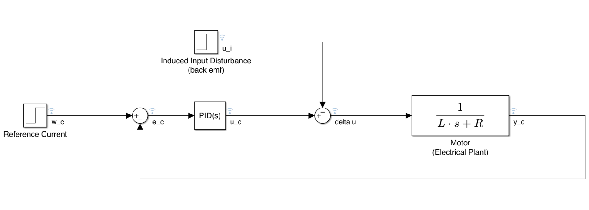
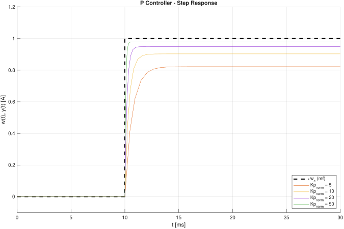
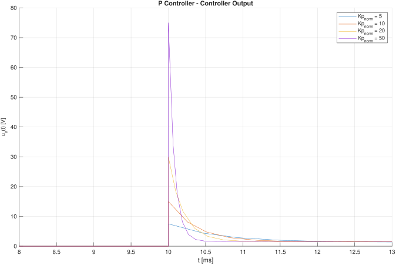
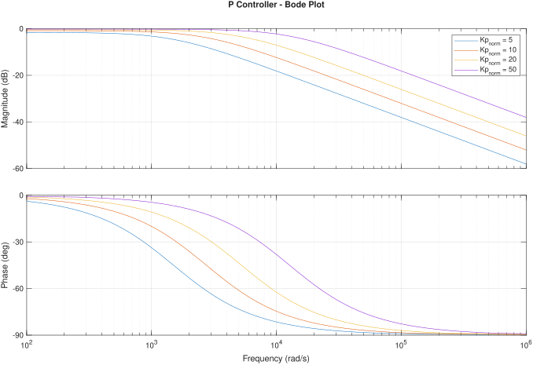
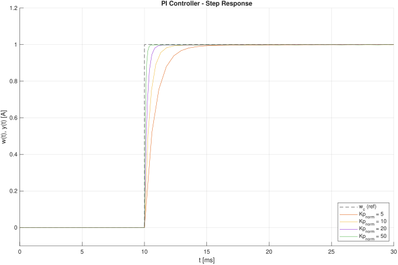
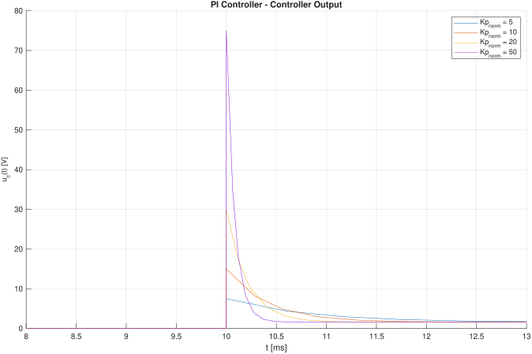
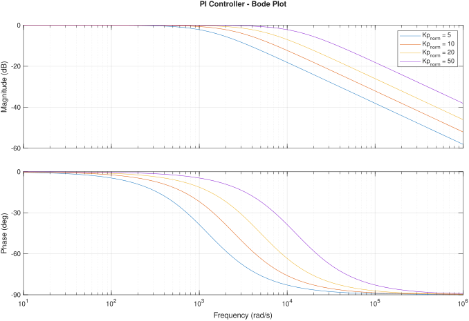

# Analysis 01: P vs. PI Current Control (Continuous-Time)

This folder contains the ideal continuous-time current-control loop simulation used to establish a baseline for tracking performance and constant induced disturbance rejection.

### Simulation Model

### Control Architectures

The system evaluates a $1\\text{ A}$ reference step ($w\_c$) under a constant back-EMF induced voltage disturbance ($u\_i$).

**1. Proportional (P) Control:**
* Controller output: $u\_c(t) = K\_p e\_c(t)$
* Plant input: ${\\Delta}u = u\_c(t) - u\_i$
* Result: The system exhibits a steady-state error proportional to the load disturbance $u\_i$ and the plant resistance $R$.  

**2. Proportional-Integral (PI) Control:**
* Controller output: $u\_c(t) = K\_p e\_c(t) + K\_i \\int\_{0}^{t} e\_c(\\tau)$
* Plant input: ${\\Delta}u = u\_c(t) - u\_i$
* Result: Due to the internal model principle, the pole at the origin ($s=0$) drives the steady-state tracking error to exactly zero, isolating and rejecting the constant $u\_i$ disturbance completely.

