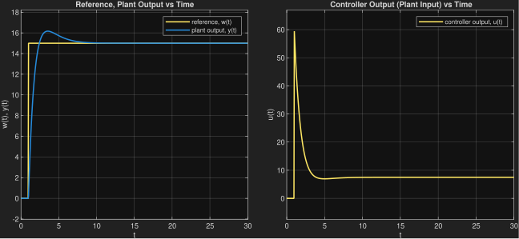
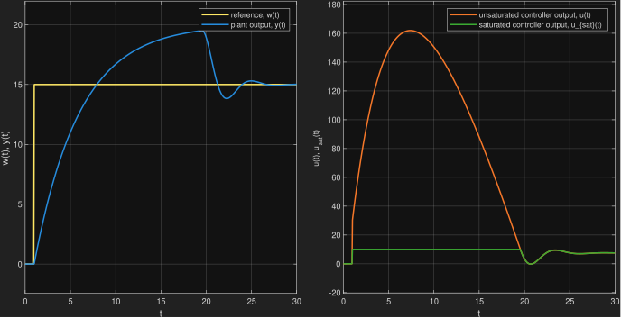
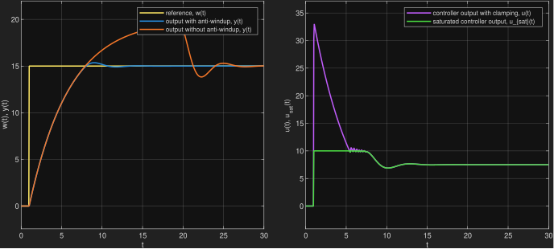
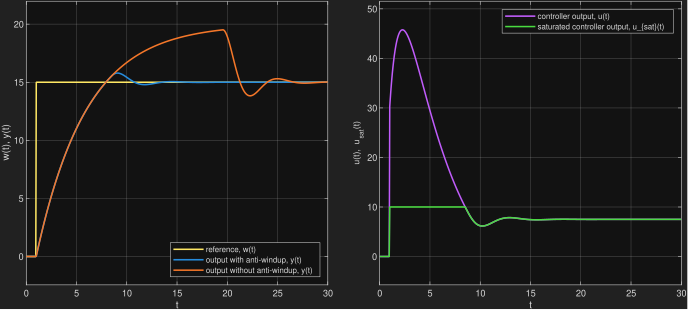

#  Plant & System Setup
The Simulink models use a 1st order plant with a PI tuning configuration:

- **Plant Transfer Function:**  

$$G(s) = \frac{Y(s)}{U(s)} = \frac{2}{5 s + 1}$$

- **Actuator Constraints:** Max limit $$u_{\text{max}} = 10$$, Min limit $$u_{\text{min}} = -10$$
- **Controller Gains:** $$K_p = 4$$, $$K_i = 2$$, $$K_d = 0$$
- **Test Profile:** Step change in setpoint from 0 to 15 at t = 1 s.

# Implementation
## 1. Standard PID Controller  
For control error $$e(t) = w(t) - y(t)$$, controller gains $$K_p$$, $$K_i$$ and $$K_d$$, the PID controller output is given by

$$u(t) = K_p e(t) + K_i \int_{0}^{t} e(\tau) d\tau + K_d \frac{de(t)}{dt}$$

In a real systems, the result cannot be applied to the plant because every actuator has a finite range. This range is modelled by the saturation block which limits the controller output.  

$$
u_sat = 
\begin{cases} 
u_{max} \text{, } & u > u_{max} \\
u \text{, } & u_{min} \leq u \leq u_{max} \\
u_{min} \text{, } & u < u_{min} 
\end{cases}
$$

## 2. Anti-Windup
### 2.1. Clamping
This approach monitors the pre-saturation voltage command u. If the command exceeds the inverter boundaries $$u > u_{max}$$ or $$u < u_{min}$$, a switch freezes the integrator state $$\(dx_I/dt = 0\))$$.  

$$\frac{dx_{I}}{dt}=(1-c)\cdot K_{I}\cdot e$$

**Note**: Because $$u$$ directly depends on the current integrator state, this creates an instantaneous algebraic feedback loop in continuous-time solvers. In Simulink, this can trigger consecutive zero-crossing event which may lead to an error. To resolve this, a Unit Delay block has been implemented after the logical OR block to break the algebraic constraint.

### 2.2. Back-calculation
Back-calculation implements a dynamic tracking feedback mechanism. It monitors the difference between the saturated controller output $$u_{sat}$$ and the unsaturated controller output $$u$$. The difference is scaled by a tracking gain $$K_b$$ and subtracted directly from the integration path.  

$$\frac{dx_{I}}{dt}=K_{I}\cdot e+K_{b}\cdot (u_{sat}-u)$$

